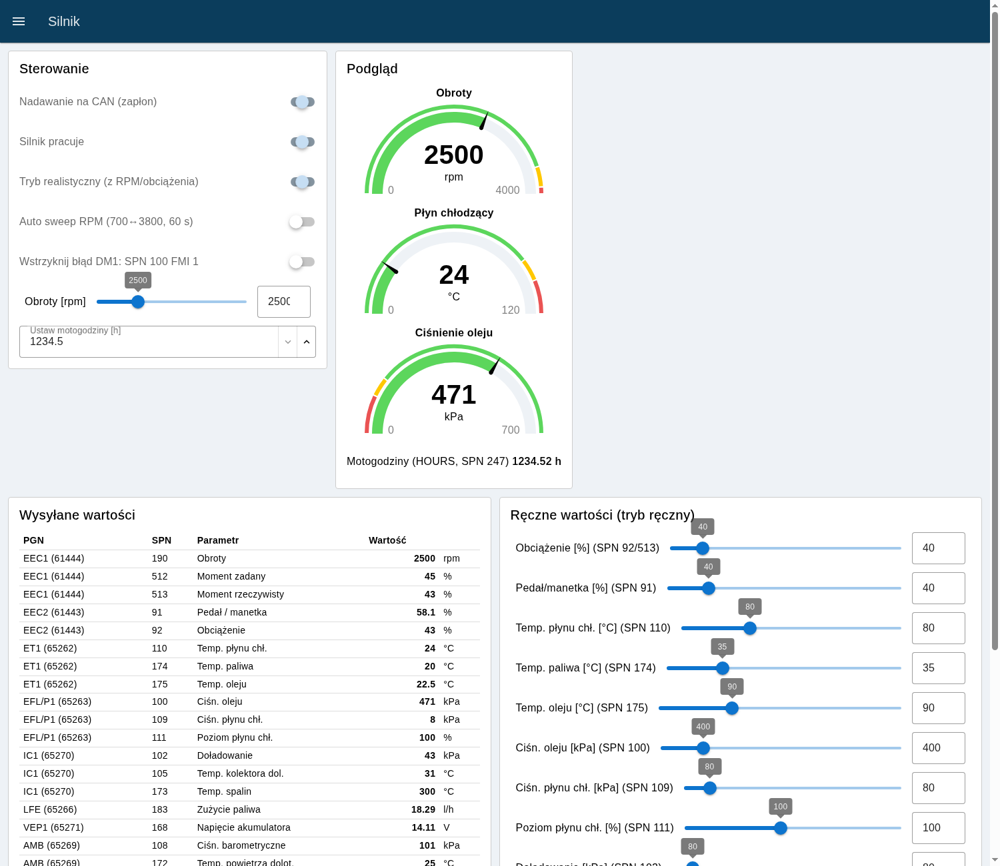

# J1939 Engine Simulator (Volvo Penta, Node-RED + SocketCAN)

Simulates a Volvo Penta marine engine on a J1939 bus (SA 0x00, 250 kbit/s, 29-bit IDs).
It transmits EEC1, EEC2, LFE, EFL/P1, IC1, ET1, AMB, VEP1, HOURS and DM1 frames on SocketCAN
(`can0` with a USB-CAN adapter, or `vcan0` with no hardware). Includes a Node-RED dashboard,
a python-can fallback (`sim.py`), a DBC file and a Docker setup.



## Quick start

```bash
./up-can.sh vcan0          # or ./up-can.sh can0 (gs_usb) / ./up-can.sh can0 slcan /dev/ttyACM0
docker compose up -d --build
# dashboard: http://localhost:1880/dashboard
candump -td vcan0
```

Without Docker: `pip install python-can && python3 sim.py -c vcan0 --sweep`.

Do not connect it to a bus with a real engine (you would get two sources with SA 0x00).
Full documentation below.

---

# Documentation: Volvo Penta engine simulator (J1939) – Node-RED + SocketCAN (WSL)

The simulator transmits J1939 engine frames (SA 0x00) on `can0` (uCAN) or `vcan0` (no hardware), at 250 kbit/s, 29-bit ID, 8 bytes, little-endian.

Files:
- `flow.json` – flow to import (tab "Volvo Penta J1939 sim" + dashboard)
- `sim.py` – fallback simulator in Python (python-can), generates identical frames
- `j1939_volvo_sim.dbc` – DBC for viewing in SavvyCAN/cantools (only these signals)
- `Dockerfile`, `docker-compose.yml`, `docker/` – container (section 7, the simplest way)
- `up-can.sh` – brings up `can0` at 250k (gs_usb or slcan) or `vcan0`
- `src/` – sources (`engine.js` = model + encoding, `build_flow.py` generates `flow.json`, `test_engine.js`)

## 1. WSL: CAN
```bash
sudo apt update && sudo apt install -y can-utils build-essential python3
```
**uCAN → can0.** First attach the USB device to WSL with usbipd-win (in PowerShell as admin: `usbipd list`, `usbipd bind --busid <X>`, `usbipd attach --wsl --busid <X>`). What happens next depends on the adapter firmware:
- as native SocketCAN (gs_usb/candleLight) it appears immediately as `can0`:
  ```bash
  sudo ip link set can0 type can bitrate 250000 && sudo ip link set can0 up
  ```
- as slcan (serial port `/dev/ttyACM0`): `sudo slcand -o -c -s5 /dev/ttyACM0 can0 && sudo ip link set can0 up` (`-s5` = 250k).

Or use one script: `./up-can.sh` (gs_usb), `./up-can.sh can0 slcan /dev/ttyACM0`, `./up-can.sh vcan0`.

**WSL kernel and CAN (checked against the microsoft/WSL2-Linux-Kernel configs):**
- Kernel **6.6.x** (older WSL): has `CAN`, `CAN_RAW`, `CAN_DEV` (modules), but **no** `vcan`, `slcan`, `gs_usb` or any other USB-CAN driver. Only USB-serial/ACM works, so without a custom kernel there is nothing to use.
- Kernel **6.18.x** (WSL since 2.7.8, June 2026; the current stable is 2.7.14): has the modules `vcan`, `slcan`, `gs_usb`, `ucan`, `peak_usb`, `kvaser_usb`, `usb_8dev`.

Check `uname -r`. If it prints 6.6, run `wsl --update` and `wsl --shutdown` in PowerShell. Then:
```bash
sudo modprobe can_raw && sudo modprobe vcan && sudo modprobe gs_usb   # or slcan
lsmod | grep -E 'can|gs_usb'
```
If `modprobe` still fails, the only option left is a custom kernel: build WSL2-Linux-Kernel with `CONFIG_CAN=m`, `CONFIG_CAN_RAW=m`, `CONFIG_CAN_DEV=m`, `CONFIG_CAN_VCAN=m`, `CONFIG_CAN_SLCAN=m`, `CONFIG_CAN_GS_USB=m` (plus `make modules_install`) and point to it in `%UserProfile%\.wslconfig`: `[wsl2]` / `kernel=C:\\...\\bzImage`.

**Test without hardware: vcan0**
```bash
sudo modprobe vcan && sudo ip link add dev vcan0 type vcan && sudo ip link set up vcan0
```

## 2. Node-RED + palettes
```bash
# Node.js 20 or 22 (e.g. via nvm or NodeSource)
sudo npm install -g --unsafe-perm node-red
node-red            # the first run creates ~/.node-red, then press Ctrl+C
cd ~/.node-red
npm install @flowfuse/node-red-dashboard node-red-contrib-socketcan
```
`node-red-contrib-socketcan` compiles a native module (`socketcan`, via node-gyp), hence `build-essential`. If npm (v11+) prints `install-scripts ... not yet covered by allowScripts`, the module was NOT built:
```bash
npm install-scripts approve socketcan bcrypt && npm rebuild socketcan bcrypt
node -e "require('socketcan'); console.log('OK')"
```
You can also install the palettes from the Manage palette menu, but then a build error is easy to miss.

**Engine hours must survive a restart:** in `~/.node-red/settings.js` uncomment or add:
```js
contextStorage: {
    default: { module: "memory" },
    file:    { module: "localfilesystem" }
},
```
Without it the counter works, but after a Node-RED restart it starts again from `VP_START_HOURS`.

## 3. Import and run
1. Run `node-red`, then open **http://localhost:1880** in a browser on Windows.
2. Menu ☰ → Import → select `flow.json` → Import → **Deploy**.
3. The interface and the counter are taken from environment variables of the Node-RED process:
   - `CAN_IF` = `can0` (default) or `vcan0`, e.g. `CAN_IF=vcan0 node-red`
   - `VP_START_HOURS` = 1234.5 (starting engine hours, used only when there is no saved state)
   - `VP_STORE` = `file` (default)

   Without restarting Node-RED: double-click the tab (Edit flow) → *Environment variables* → change `VP_CAN_IF` (default `$env("CAN_IF")` or `can0`) or add `VP_START_HOURS`, then Deploy.
4. Dashboard: **http://localhost:1880/dashboard**

Controls:
- *Transmit on CAN (ignition)*: switches TX on and off.
- *Engine running*: when off, RPM = 0, frames keep being sent (ignition on, engine not running), and engine hours stand still.
- *Realistic mode*: from the RPM slider and the propeller curve (load ~ rpm²) it computes load, torque, temperatures (warming up to ~80 °C), oil pressure, boost, exhaust gas, fuel consumption and voltage. When off, every parameter comes from its slider in "Manual values".
- *Auto sweep*: RPM ramp 700↔3800 rpm, period 60 s.
- *DM1 fault*: SPN 100 FMI 1 (oil pressure too low) with the red STOP lamp; oil pressure drops to 40 kPa.
- *Set engine hours*: overwrites the counter.

Engine hours increase only when RPM > 0, are computed from real time, and are saved every 10 s and on Deploy/stop.

## 4. Verification
```bash
candump -td can0          # or vcan0
candump -td -c can0,0CF00400:1FFFFFFF   # EEC1 only
```
Example for manual mode, 1500 rpm, coolant 82 °C, 1234.5 h:
```
 (000.020011)  can0  0CF00400   [8]  FF A5 A5 E0 2E FF FF FF    EEC1: bytes 4-5 = 0x2EE0 = 12000 * 0.125 = 1500 rpm; torque 0xA5-125 = 40 %
 (000.009870)  can0  0CF00300   [8]  FF 64 28 FF FF FF FF FF    EEC2: pedal 0x64*0.4 = 40 %, load 0x28 = 40 %
 (000.010120)  can0  18FEF200   [8]  F0 00 FF FF FF FF 64 FF    LFE: 0x00F0*0.05 = 12 l/h
 (000.200000)  can0  18FEEF00   [8]  FF FF FF 64 FF FF 28 FA    EFL/P1: oil 0x64*4 = 400 kPa, coolant 0x28*2 = 80 kPa, level 0xFA*0.4 = 100 %
 (000.000000)  can0  18FEF600   [8]  FF 28 50 FF FF E0 4D FF    IC1: boost 80 kPa, manifold 40 °C, exhaust 0x4DE0*0.03125-273 = 350 °C
 (000.000000)  can0  18FEEE00   [8]  7A 4B 60 2D FF FF FF FF    ET1: coolant 0x7A-40 = 82 °C, fuel 35 °C, oil 0x2D60*0.03125-273 = 90 °C
 (000.000000)  can0  18FEF500   [8]  CA FF FF FF FF 41 FF FF    AMB: 0xCA*0.5 = 101 kPa, intake air 0x41-40 = 25 °C
 (000.000000)  can0  18FEF700   [8]  FF FF FF FF 1C 01 FF FF    VEP1: 0x011C*0.05 = 14.2 V
 (000.000000)  can0  18FEE500   [8]  72 60 00 00 01 B2 01 00    HOURS: 0x00006072*0.05 = 1234.5 h; revolutions 0x0001B201*1000
 (000.000000)  can0  18FECA00   [8]  00 FF 00 00 00 00 FF FF    DM1: no faults (with a fault: 10 FF 64 00 01 01 FF FF)
```
SavvyCAN: load `j1939_volvo_sim.dbc` to get decoded signals and plots.

## 5. Frames and parameters
| PG | PGN (hex) | CAN ID | Period | SPN | Parameter | Bytes (from 1) | Scale / offset |
|---|---|---|---|---|---|---|---|
| EEC1 | 61444 (F004) | 0CF00400 | 20 ms | 512 | Driver's demand torque | 2 | 1 %/bit, −125 % |
| | | | | 513 | Actual engine torque | 3 | 1 %/bit, −125 % |
| | | | | 190 | Engine speed | 4–5 | 0.125 rpm/bit |
| EEC2 | 61443 (F003) | 0CF00300 | 50 ms | 91 | Accelerator pedal position 1 | 2 | 0.4 %/bit |
| | | | | 92 | Percent load at current speed | 3 | 1 %/bit |
| LFE | 65266 (FEF2) | 18FEF200 | 100 ms | 183 | Fuel rate | 1–2 | 0.05 l/h/bit |
| | | | | 51 | Throttle position (= pedal) | 7 | 0.4 %/bit |
| EFL/P1 | 65263 (FEEF) | 18FEEF00 | 500 ms | 100 | Oil pressure | 4 | 4 kPa/bit |
| | | | | 109 | Coolant pressure | 7 | 2 kPa/bit |
| | | | | 111 | Coolant level | 8 | 0.4 %/bit |
| IC1 | 65270 (FEF6) | 18FEF600 | 500 ms | 102 | Intake manifold 1 (boost) pressure | 2 | 2 kPa/bit |
| | | | | 105 | Intake manifold 1 temp | 3 | 1 °C/bit, −40 |
| | | | | 173 | Exhaust gas temp | 6–7 | 0.03125 °C/bit, −273 |
| ET1 | 65262 (FEEE) | 18FEEE00 | 1 s | 110 | Coolant temp | 1 | 1 °C/bit, −40 |
| | | | | 174 | Fuel temp | 2 | 1 °C/bit, −40 |
| | | | | 175 | Oil temp 1 | 3–4 | 0.03125 °C/bit, −273 |
| AMB | 65269 (FEF5) | 18FEF500 | 1 s | 108 | Barometric pressure | 1 | 0.5 kPa/bit |
| | | | | 172 | Engine air inlet temp | 6 | 1 °C/bit, −40 |
| VEP1 | 65271 (FEF7) | 18FEF700 | 1 s | 168 | Battery potential | 5–6 | 0.05 V/bit |
| HOURS | 65253 (FEE5) | 18FEE500 | 1 s* | 247 | Total engine hours | 1–4 | 0.05 h/bit |
| | | | | 249 | Total revolutions | 5–8 | 1000 r/bit |
| DM1 | 65226 (FECA) | 18FECA00 | 1 s | 100 / FMI 1 | Active DTC (optional) | 1–6 | lamps, SPN, FMI, OC |

Unused bytes are 0xFF (not available). Bus load is about 85 frames/s, i.e. ~5 % at 250k.
\* In J1939, HOURS is normally "on request" (PGN 59904). Here it is transmitted cyclically every 1 s for the convenience of the logger. The simulator does not handle request messages.

Node-RED keeps the 20 ms period of EEC1 without problems (10 ms timer, a few ms of jitter). If WSL chokes, change `period: 20` to 50 in `src/engine.js`, run `python3 src/build_flow.py` and import the flow again.

## 6. Fallback: Python
```bash
pip install python-can
python3 sim.py -c can0                 # realistic mode, 1500 rpm
python3 sim.py -c vcan0 --sweep        # RPM ramp
python3 sim.py -c can0 --manual --rpm 1500 --coolant 82 --fault
python3 sim.py -c can0 --engine-off    # ignition on, engine stopped
```
Engine hours are saved in `~/.vp_sim_hours.json`, and `--hours 1234.5` sets the counter.

## 7. Docker (docker compose) in WSL

**Does USB pass through to WSL? Yes, via usbipd-win.** In PowerShell as admin:
```powershell
winget install usbipd          # once
usbipd list                    # find the BUSID of the uCAN, e.g. 2-3
usbipd bind --busid 2-3        # once (share the device)
usbipd attach --wsl --busid 2-3   # after every re-plug / WSL restart (or: --auto-attach)
```
In WSL, `lsusb` should show the adapter. Then `./up-can.sh` (gs_usb) or `./up-can.sh can0 slcan /dev/ttyACM0` and `ip -details link show can0`. A WSL kernel with CAN modules is required (section 1).

**Install Docker Engine inside the WSL distribution, not Docker Desktop.** `can0` is a network interface in the network namespace of the WSL distribution. A container sees it only with `network_mode: host`, i.e. when it shares that namespace. Docker Desktop runs containers in a separate VM (`docker-desktop`), and its "host network" is just TCP/UDP port forwarding. The `can0` of your distribution is not there, so the simulator would not send a single frame. If you have Docker Desktop, disable its WSL integration for this distribution and install the Engine in it:
```bash
curl -fsSL https://get.docker.com | sudo sh
sudo usermod -aG docker $USER      # log out/in (wsl --shutdown)
sudo service docker start          # or systemd=true in /etc/wsl.conf
```

**Running:**
```bash
./up-can.sh                        # or ./up-can.sh vcan0
cp .env.example .env               # optional: CAN_IF, VP_START_HOURS
docker compose up -d --build
docker compose logs -f
candump -td can0                   # in a second terminal: frames
```
Open the dashboard in a browser on Windows: **http://localhost:1880/dashboard**, editor: http://localhost:1880. In host mode Node-RED listens on :1880 inside WSL, and WSL forwards localhost to Windows. It also works with `networkingMode=mirrored` in `.wslconfig`.

- Image: `nodered/node-red:4.1.17-22` (Node-RED 4.1.17, Node 22), `node-red-contrib-socketcan@1.4.2` with the native module built in the builder stage (build-base, python3, linux-headers; `node-gyp rebuild` called directly, with no dependence on npm allowScripts) and `@flowfuse/node-red-dashboard@1.34.1`. You do not need to install the palettes by hand.
- The flow is baked into the image and copied to the `/data` volume on the first start. Your changes in the editor stay in the volume. To load the flow from the image again (e.g. after a rebuild): `FLOW_RESET=1 docker compose up -d`, then start again without that variable.
- Engine hours: the `file` store is enabled, and the state lives in the `vp_data` volume (`/data/context`). It survives `docker compose down` and a rebuild, but not `down -v`.
- `CAN_IF=vcan0 docker compose up -d` changes the interface. The interface must exist before the container starts. If it is missing, the log shows the warning `[vp-sim] UWAGA` and an error for every frame. Logs are limited to 3×10 MB. After `./up-can.sh`, run `docker compose restart`.
- The Python fallback as a container: `docker compose --profile py up sim` (default `--sweep`, other options via `SIM_ARGS="--manual --rpm 1500"`). Do not run it together with Node-RED on the same interface.

## Notes
- Real Volvo Penta EDC/EVC units also transmit proprietary frames (PGN 0xFFxx) and use several source addresses. The simulator transmits only standard J1939 PGNs with SA 0x00.
- The model in realistic mode is indicative: propeller curve, D4/D6, 700–3800 rpm, ~60 l/h at full load. It does not reproduce a specific engine.
- Do not connect the simulator to a bus with a real engine, because there would be two sources with SA 0x00.

## License

MIT, see [LICENSE](LICENSE).